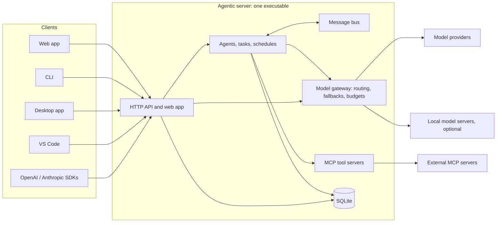

<div align="center">


# Agentic

**A self-hosted server for teams of AI agents, and the people who work with them.**

[](https://github.com/smurflabs/Agentic/actions/workflows/docker.yml)
[](LICENSE)


[Quick start](#quick-start) · [Features](#features) · [Setup guide](SETUP.md) · [Reference manual](docs/REFERENCE.md) · [Client apps](#client-apps)

</div>

---

## What is Agentic?

Agentic runs a team of AI agents on your own infrastructure. Each agent has a role, goals, private memory, its own permissions and a budget. Agents take work from a queue, run on schedules, plan larger requests together, delegate to each other and do real work with tools such as files, git, databases, documents and the web, through the [Model Context Protocol](https://modelcontextprotocol.io) (MCP). When an agent needs a decision, it asks a person.

Around the agents, Agentic is a complete AI workspace for people. It has a chat app with tools and a code interpreter, OpenAI- and Anthropic-compatible APIs, and client apps for the terminal, the desktop and VS Code. All of them share the same accounts, permissions and models.

Agentic works with any OpenAI-compatible model provider, such as OpenWebUI, LiteLLM, vLLM, llama.cpp or a hosted API, and optionally with your own local GPU servers. Each request is routed by purpose and price, and falls back to another provider when one fails. Cloud usage is paid from a wallet with a ledger, so autonomous work stays within the limits you set.

The server is one self-contained executable with an embedded web app and a SQLite database. There is no separate web server, database server or front-end build to run.

## Features

### Autonomous agents

- **Isolated agents (up to 50).** Each agent is a supervised loop with its own memory, files, permissions, models and wallet. No agent can read another agent's memory, tasks or credentials.
- **Tasks and schedules.** Each agent has a queue with drag-and-drop ordering, priorities, deadlines, off-peak work, and interval or cron schedules.
- **Collaboration with guard rails.** Agents ask each other for help and delegate work through one permissioned, audited message system, with loop, depth and rate limits.
- **Global tasks.** A single request is planned into steps, spread over the right agents and combined into one answer.
- **Subagents.** An agent can start temporary helpers for parallel work, each with its own spend cap.
- **Autonomy levels.** Levels range from supervised to fully autonomous. They cover budget policies, supervisor agents, initiative when idle, hiring new agents and bounties. Behaviour changes are evaluated and rolled back when they make an agent worse.
- **Human in the loop.** Questions and approvals wait in an Inbox, and any tool can require approval for each call.
- **Organizational learning.** When an agent runs out of money or earns a lot, its decisions are studied and the lessons are shared with every agent.

### Models and routing

- **Any OpenAI-compatible provider**, plus optional **local models** with a configurable number of parallel slots, or none at all.
- **Routing by purpose.** Each kind of work (coding, research, analysis, …) has an escalation ladder, and a stronger model is used only when the task needs one.
- **Resilience:**
  - fallbacks at other providers for each model
  - circuit breakers
  - out-of-credit detection
  - retries that keep the work already done
  - context windows learned from real provider responses
- **Custom models.** One model name sends each request to the model you chose for that kind of work (coding, maths, vision, long context, …), using rules, a classifier or both.
- **Bring your own model.** Users can add their own API keys and models for private use.

### Budgets and accounting

- **Wallets and an append-only ledger** in micro-USD. Every cloud call reserves its cost first and settles the real usage afterwards.
- **Price controls:** a price per model (Model Square), daily limits and global caps.
- **Agent finances:** burn-rate and runway forecasts, and profit and ROI per agent.
- **Account balances for people,** with usage per user, model and API key, and optional deposits through BTCPay.

### Tools (MCP)

- **MCP client** for stdio and HTTP servers. It reconnects and health-checks servers, controls access per agent and per user, and applies approval rules.
- **16 built-in tool servers** in the same executable:
  - files and code: shared storage, shell, git, Gitea, code review, files and OCR
  - documents and data: documents (reading and writing PDF and Office files), databases (SQLite, PostgreSQL, MySQL, SQL Server), data and charts
  - systems: network checks and SSH, Docker, Windows administration, dependency audits
  - other: email, utilities, public lookups
- **Tools loaded on demand.** Agents get a tool's description only when they need it, which keeps prompts small even with many servers.
- **Personal MCP servers** for each user, private or shared, with OAuth sign-in.

### Chat and workspace

- **Chat with every provider and custom model.** Answers stream with their reasoning. You can attach files and images, search the web (with citations), use knowledge bases (RAG), and keep projects, memories and saved prompts.
- **Tools in chat:**
  - MCP tools and a code interpreter
  - tool cards, diffs, approvals and permission modes
  - goals, plans and task lists for long work
  - artifacts with shareable links
- **Pictures, video and speech:** image and video generation, reading answers aloud, and voice dictation.
- **Live in every window.** An answer streams to every open browser tab, the desktop app and VS Code at once.
- **Optional tabs:** Audio (XTTS), Images (Stable Diffusion), Music, Money (crypto and currencies), Stocks, Polymarket and News.

### Operations and security

- **Operations console:** live overview, operations center, emergency stop, workflow timelines, live events, results and reviews, and a communication topology graph.
- **Accounts and permissions:** administrators and users with fine-grained permissions, agent and model scopes, per-user limits and personal API keys.
- **Secure by default:**
  - PBKDF2 password hashes, CSRF protection and a strict Content Security Policy
  - secrets taken from the environment or an encrypted vault, and redacted from logs
  - a full audit log
  - a guard against destructive shell commands
- **Built to stay up.** Tasks are checkpointed and resume after a restart, agents restart with backoff, stuck work is detected, and backups and data retention run automatically.
- **Monitoring:** `/healthz`, Prometheus metrics and alert webhooks.

### APIs and client apps

- **OpenAI-compatible API** (`/v1/chat/completions`, `/v1/models`, `/v1/embeddings`, `/v1/images/generations`) and an **Anthropic-compatible** `/v1/messages`. Existing SDKs and tools connect with an Agentic API key.
- **REST API** for everything the web app does, documented interactively with Swagger.
- **Client apps** for the terminal, the desktop and VS Code. The server distributes and updates them itself.

## Quick start

### Docker

```bash
curl -O https://raw.githubusercontent.com/smurflabs/Agentic/main/docker-compose.yml
curl -o .env https://raw.githubusercontent.com/smurflabs/Agentic/main/.env.example
# Edit .env: set OPENWEBUI_BASE_URL and OPENWEBUI_API_KEY to your model provider
docker compose up -d
docker compose logs agentic       # shows the one-time password for "admin"
```

Open <http://localhost:8080> and sign in as `admin`. The image is [`ghcr.io/smurflabs/agentic`](https://github.com/smurflabs/Agentic/pkgs/container/agentic).

### Windows

Requires the [.NET 10 SDK](https://dotnet.microsoft.com/download/dotnet/10.0).

```powershell
git clone https://github.com/smurflabs/Agentic.git
cd Agentic
dotnet publish src\Agentic\Agentic.vbproj -c Release -r win-x64 -o C:\Agentic
setx AGENTIC_AIProviders__OpenWebUI__ApiKey "sk-..."      # then open a new console
# In C:\Agentic\appsettings.json, set AIProviders.OpenWebUI.BaseUrl and your models
C:\Agentic\Agentic.exe --validate-config
C:\Agentic\Agentic.exe
```

Open <http://127.0.0.1:8080> and sign in as `admin` with the password printed on the first start.

**Next steps.** Point the model keys at your provider's models, set their prices, create accounts, and decide whether you run local models. [SETUP.md](SETUP.md) walks through each step.

## Client apps

| App | Repository | What it does |
|---|---|---|
| **Agentic CLI** | [Agentic_CLI](https://github.com/smurflabs/Agentic_CLI) | A coding agent in your terminal: the tools run on your machine, the models on your server. |
| **Agentic Desktop** | [Agentic_Client](https://github.com/smurflabs/Agentic_Client) | The web app in a window of its own on Windows and Linux. It adds local MCP servers, Claude Code skills, and file and command tools that ask for approval. |
| **Agentic for VS Code** | [Agentic_VSCODE](https://github.com/smurflabs/Agentic_VSCODE) | Chat inside VS Code, with tools that read, edit and run code in your workspace. |

Every client signs in with a personal API key. In the web app, open the user menu and choose **API key**. Once an administrator publishes the clients from the server (`tools/publish-clients.ps1`), people download them from **Apps & updates**, and installed copies update themselves.

## How it works



- **One way between agents.** Agents never talk to each other directly. Every request, delegation and reply goes through the message bus, which checks permissions and limits and records everything.
- **One way to the models.** Every model call goes through the model gateway. The gateway chooses the model the agent is allowed to use and can afford, waits for a local slot or spills over to the cloud, and charges the agent's wallet.
- **Tools in separate processes.** Built-in tool servers run as child processes of the same executable, and external MCP servers connect over stdio or HTTP. Each agent sees only the tools it was granted.

## Configuration

All settings live in `appsettings.json`, which allows comments. Any setting can be overridden with an environment variable named `AGENTIC_<Section>__<Key>`, for example `AGENTIC_Server__Port=9090`. Keep secrets in environment variables or in the server's encrypted vault, never in the file.

| Section | What it sets |
|---|---|
| `AIProviders` | The model provider: base URL and API key |
| `Models` | The models agents and chat can use, by key, with capabilities, prices and fallbacks |
| `LocalModels` | Whether you run local models, and how many requests each serves at once |
| `Routing` | Escalation ladders, spillover from local to cloud, and fallback behaviour |
| `BaseProfiles`, `Agents` | The agents: roles, goals, models, tools, budgets and autonomy |
| `McpServers` | Tool servers and who may use them |
| `Server`, `Admin` | Address, port, public URL, users and API tokens |

`Agentic.exe --validate-config` checks the whole file and names each problem. The [reference manual](docs/REFERENCE.md#7-configuration) describes every section.

## Documentation

- **[SETUP.md](SETUP.md):** installation and configuration, step by step, on Windows or with Docker.
- **[docs/REFERENCE.md](docs/REFERENCE.md):** the complete manual covering agents, routing, the economy, MCP servers, chat, the APIs and operations.
- **Swagger:** in the web app, an interactive reference for the REST API.

## Building and testing

```powershell
dotnet build Agentic.slnx
dotnet test  Agentic.slnx
```

The test suite has about 800 xUnit tests. They run against a scriptable fake model provider and temporary SQLite databases.

| Folder | Contents |
|---|---|
| `src/Agentic` | The server: agents, routing, economy, MCP, HTTP API, and the embedded web app (`Dashboard/`, plain JavaScript, no build step) |
| `tests/Agentic.Tests` | The test suite |
| `samples/EchoMcpServer` | A minimal MCP server, used as a template and in the tests |
| `tools/` | Publish scripts, the MSI builder and the Node.js tool packages |
| `docker/`, `Dockerfile`, `docker-compose.yml` | The container image |

How it is built:
- VB.NET on .NET 10, with `Option Strict On` throughout
- `HttpListener` instead of ASP.NET
- SQLite in WAL mode
- the official MCP C# SDK
- every package version pinned

## Security

The server listens on `127.0.0.1` by default. To reach it from other machines, put an HTTPS reverse proxy in front of it, or use a VPN or private network. Do not expose it directly to the internet. The tools agents use can act on the machine they run on, so grant them with care. Shell commands need an administrator's approval by default.

Please report security issues privately through this repository's **Security** tab, not in public issues.

## License

Agentic is free software: you can redistribute it and/or modify it under the terms of the [GNU General Public License](LICENSE) as published by the Free Software Foundation, either version 3 of the License, or (at your option) any later version.

Bundled third-party files keep their own licenses: KaTeX (MIT) and Swagger UI (Apache-2.0), in `src/Agentic/Dashboard/vendor/`.
